<div align="center">



<a href="https://github.com/ahhhatem500-cmd">
  
</a>

<br/>

<a href="mailto:ahhhatem500@gmail.com">
  
</a>
<a href="https://github.com/ahhhatem500-cmd">
  
</a>
<a href="https://www.linkedin.com/in/ahmed-hatem-5674a7391">
  
</a>
<a href="https://t.me/Eng_Ahmed_Hatem1030">
  
</a>


</div>

<br/>

<details open>
<summary><h2>🛰️ About Me</h2></summary>

I'm a **Communications Engineering** student fascinated by one question:
*how does information actually get from a transmitter to a receiver — and how do we make it faster, cleaner, and more reliable?*

My workflow is simple:

```text
Theory  →  Simulation  →  Implementation  →  Visual explanation
```

- 📶 **Core interest:** digital communications — modulation, OFDM, channel coding, and RF front-ends
- 📐 **Radio planning:** ATOLL (Forsk) — coverage, capacity, and optimisation for 2G / 3G / 4G / 5G networks
- 🧪 **Simulation:** MATLAB / Simulink models of transceivers, filters, and link budgets
- 🔬 **Digital & circuit design:** Logisim (logic), ModelSim (HDL), Proteus (circuits / microcontrollers)
- 🧫 **Lab bench:** TIMS (Emona) platform for building and measuring communication-system experiments
- 📡 **Radio:** GNU Radio + Software Defined Radio experiments (spectrum, demodulation, framing)
- 🌐 **Networks:** OSI & TCP/IP layers, routing basics, Cisco Packet Tracer, packet analysis with Wireshark
- 🤖 **Explaining:** I animate engineering concepts with **Manim** — creator of **Visualized Math**, where hard ideas become obvious visuals
- 🌱 **Currently exploring:** 5G NR fundamentals, MIMO, Python for DSP, and embedded C

</details>

---

<details open>
<summary><h2>🛠️ Tech Stack</h2></summary>

<h3>💻 Languages</h3>
<p>
  
  
  
  
  
</p>

<h3>📡 Communications &amp; DSP</h3>
<p>
  
  
  
  
  
  
</p>

<h3>🌐 Networking</h3>
<p>
  
  
  
</p>

<h3>🔌 Embedded &amp; Hardware</h3>
<p>
  
  
  
  
</p>

<h3>🔬 Simulation, EDA &amp; Lab</h3>
<p>
  
  
  
  
  
  
</p>

<h3>🧰 Tools</h3>
<p>
  
  
  
  
  
</p>

</details>

---

<details open>
<summary><h2>🚀 Projects</h2></summary>

<table>
  <tr>
    <td width="50%" valign="top">
      <h3>🎬 <a href="https://github.com/ahhhatem500-cmd/manim">manim</a></h3>
      <p>Scene code and experiments behind <b>Visualized Math</b> — animated explanations of engineering &amp; mathematical ideas.</p>
      
      
    </td>
    <td width="50%" valign="top">
      <h3>🧪 Coming soon</h3>
      <p>DSP experiments, communication-system simulations, and small SDR projects are in progress.</p>
      
    </td>
  </tr>
</table>

</details>

---

<details open>
<summary><h2>📫 Let's Connect</h2></summary>

<p align="center">
  Open to collaboration on <b>communication systems</b>, <b>DSP</b>, and <b>embedded / IoT</b> projects.<br/>
  Have an idea, a question, or just want to talk signals? My inbox is always open.
</p>

<p align="center">
  <a href="mailto:ahhhatem500@gmail.com">
    
  </a>
  <a href="https://www.linkedin.com/in/ahmed-hatem-5674a7391">
    
  </a>
  <a href="https://t.me/Eng_Ahmed_Hatem1030">
    
  </a>
</p>

<p align="center">
  📧 <a href="mailto:ahhhatem500@gmail.com"><b>ahhhatem500@gmail.com</b></a>
</p>

</details>

<br/>

<div align="center">
  <sub><i>“Any sufficiently advanced communication system is indistinguishable from magic.”</i></sub>
</div>
